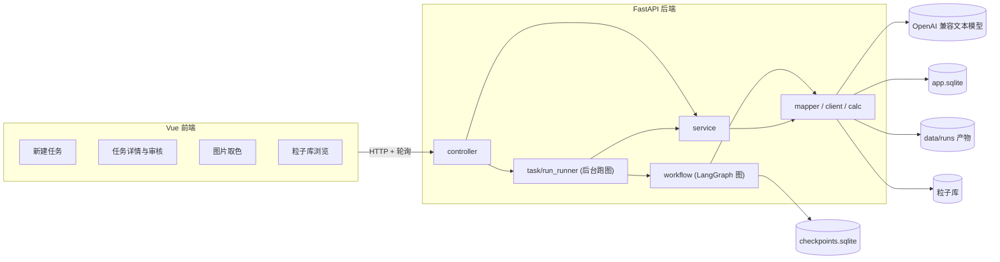
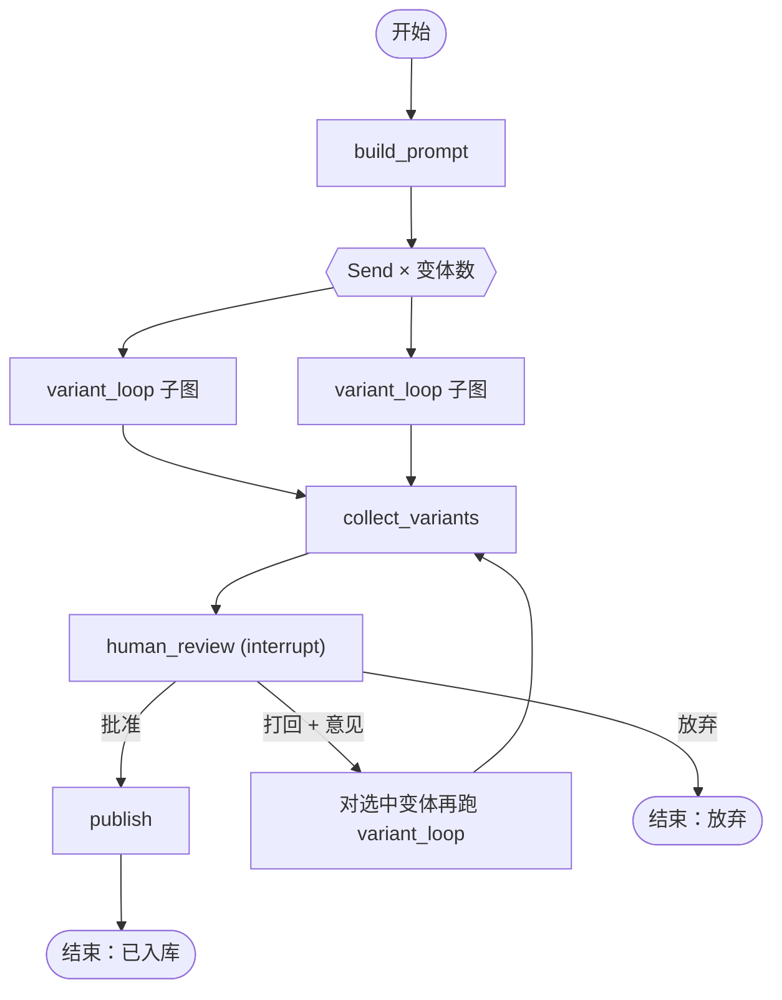
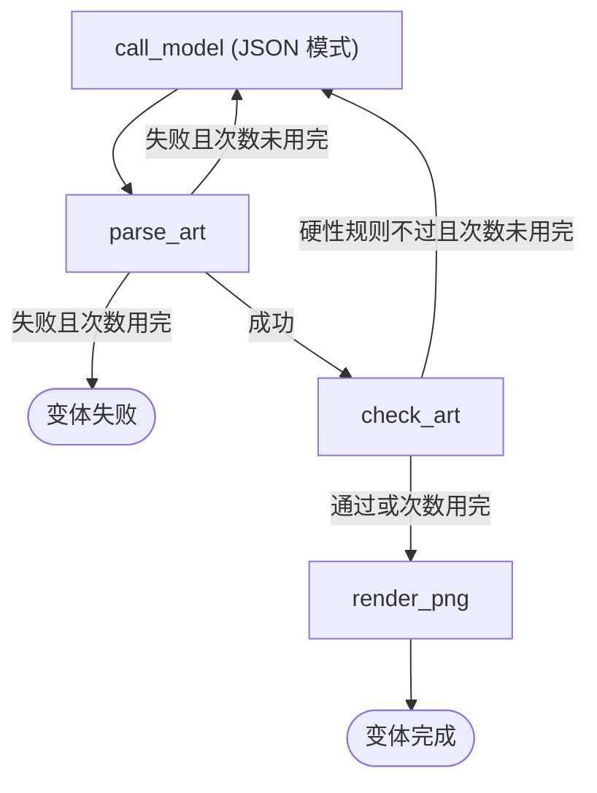
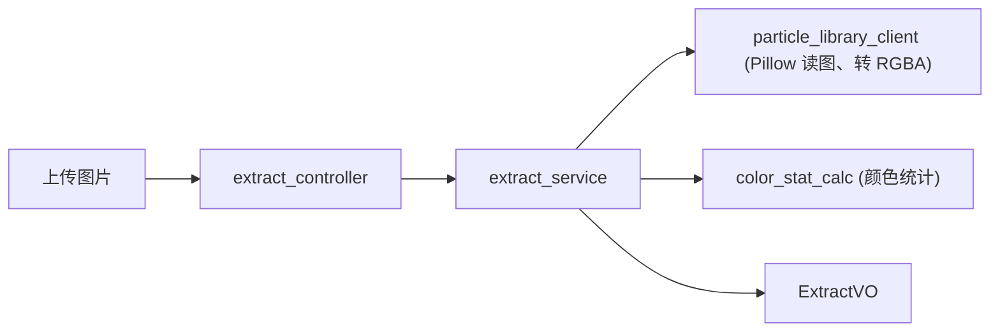

# 粒子工坊 — 设计文档

> 状态：草案 v0.3（未动工）
> 技术栈：后端 Python + FastAPI + LangGraph（结构照搬 `D:\java_object\上班了\stock\backend`）；前端 Vue 3 + ant-design-vue（目录分层借鉴 `D:\java_object\上班了\stock\frontend`）。
> 本机单用户工具，不登录。与 `粒子库/`、`工具链/` 并列放在父目录。

两个**互相独立**的功能：

| 功能 | 做什么 | 是否调大模型 |
|---|---|---|
| 功能一：AI 生成像素画 | 按钮 + 描述拼出提示词 → 模型返回紧凑 JSON → 校验 → 拼成 PNG → 人工审核 → 入库 | 是（LangGraph 工作流） |
| 功能二：图片逐像素取色 | 上传一张图 → 导出每个像素的 RGBA（32 位，含透明度）+ 颜色列表 | 否 |

---

## 1. 背景与目标

### 1.1 现状

`粒子库/` 目前有约 585 张 PNG、153 份像素 JSON（`tool/origin_json/`）、约 15 个 `tool/gen_*.py` 生成脚本。

- 现有「让大模型画像素」的手工流程：让模型按 `name / width / height / pixels` 输出 JSON，再用 `tool/render_pixel_art.py` 拼成 PNG。
- 取色有命令行脚本 `tool/extract_image_rgba.py`，但没有可视化界面。
- 入库步骤（写 PNG、写 JSON、重跑总览图）分散在几条命令里。

### 1.2 目标

**功能一：AI 生成像素画**

1. 前端用按钮选尺寸、类别、色调、描边、对称、变体数，再写一句描述；后端把两者拼成完整提示词，生成前可预览。
2. 模型直接返回**紧凑像素 JSON**（调色板 + 逐行字符串），后端校验后转成标准像素 JSON，再拼成 PNG。
3. 格式错误或规则检查不通过时，把具体错误回传给模型重试，有次数上限。
4. 人在页面上审核：批准 / 打回附意见 / 放弃。
5. 批准后一键入库到 `粒子库/`，并重跑总览图。
6. 每次调用的提示词、模型原始返回、检查报告、PNG 都可追溯。

**功能二：图片逐像素取色**

1. 上传一张图片，输出每个像素的 RGBA（每通道 8 位，共 32 位），格式与现有像素 JSON 一致。
2. 透明度完整保留；RGB、调色板、灰度等格式统一转成 RGBA。
3. 页面上放大查看，鼠标悬停显示坐标和颜色；列出所有不重复颜色及数量。
4. 一键复制 / 下载 JSON。

### 1.3 已确认的决定

| 项 | 决定 |
|---|---|
| 后端结构 | 照搬 stock 的 `common / pojo / server` 三层、`Result` 返回体、全局异常处理、`MessageConstant`、业务日志、import-linter 依赖约束、uv + 腾讯镜像、ruff、pytest |
| 前端结构 | Vue 3 + TypeScript + Vite + ant-design-vue 4 + vue-router 4；目录分层、请求封装、命名注释约定借鉴 stock 前端 |
| 登录 | 不要。去掉 JWT、interceptor、Redis |
| 存储 | SQLAlchemy 异步 + entity / mapper 写法不变，数据库换 SQLite（aiosqlite）；LangGraph 状态用 `langgraph-checkpoint-sqlite` |
| 模型 | 只用一个 OpenAI 兼容的文本模型（默认 DeepSeek），客户端写法照搬 stock 的 `server/client/llm_client.py`；不用 langchain |
| 出图方式 | 模型返回紧凑 JSON，后端转换后复用 `render_pixel_art.py` 拼 PNG |
| 进度推送 | 前端轮询（仿 stock 的 `usePolling` + pipeline 页面），不用 SSE；所有接口统一走 `{code, message, data}` |
| 端口 | 前端 5175、后端 8002（避开 stock 的 5174 / 8001） |

### 1.4 非目标（第一版不做）

- 不让模型写代码，不做沙箱，不做视觉模型评审。
- 不做多用户、登录、云部署。
- 不重构现有 `gen_*.py`；不自动改 Forge / NeoForge 工程（粒子注册、拷贝 assets 仍手动）。
- 不做动画帧序列（`bird_flap_*` 这类）。
- 功能二不做调色板合并 / 减色、不做大图转像素画、不保留高于 8 位的通道精度。
- 两个功能之间不联动。

---

## 2. 总体架构



功能一的运行方式：

1. `POST /particle-runs` 写入任务记录，交给 `task/run_runner.py` 在后台 asyncio 任务里执行图，接口立即返回任务 ID。
2. `run_runner` 消费 `graph.astream(...)` 的输出，把每一步转成事件写进 `particle_run_event` 表（带递增 `seq`），把每次模型调用写进 `particle_attempt` 表。
3. 前端每秒轮询 `GET /particle-runs/{id}/events?after_seq=N` 拿增量事件，任务结束或进入审核后停止轮询。
4. 图停在 `human_review`（LangGraph `interrupt`）时，状态已存进 checkpoint；服务重启后仍可用 `POST /resume` 继续。
5. 服务启动时，把状态仍为「运行中」的任务标记为「已中断」（后台任务随进程消失）；「待审核」的任务不受影响。

功能二：一次请求一次响应，不落盘、不存历史。

---

## 3. 后端结构（照搬 stock）

### 3.1 目录

```
粒子工坊/backend/
├─ pyproject.toml                 # uv、腾讯镜像、ruff、pytest、import-linter
├─ .env.example
├─ Readme.md
├─ common/                        # 不依赖上层
│  ├─ constant/
│  │  ├─ message_constant.py      # 所有返回给前端的文案
│  │  ├─ canvas_size.py           # 64 / 32 / 16 / 8 尺寸参数表（第 5.2 节）
│  │  ├─ particle_option.py       # 按钮选项：类别、色调（含锚点颜色）、描边、对称
│  │  ├─ prompt_template.py       # 系统提示词、各尺寸画法指南、重试 / 打回模板
│  │  ├─ run_status.py            # 任务状态枚举
│  │  └─ run_event_type.py        # 事件类型枚举
│  ├─ exception/                  # base_exception.py（BizException）、biz_exceptions.py
│  ├─ properties/                 # base / app / db / llm / workflow / extract_properties.py
│  ├─ result/                     # result.py、page_result.py
│  └─ utils/                      # log_util.py（to_log）、path_util.py
├─ pojo/                          # 只依赖 common
│  ├─ dto/
│  │  ├─ particle_run_dto.py      # RunOptionsDTO、RunCreateDTO、RunResumeDTO、RunQueryDTO
│  │  └─ prompt_dto.py            # PromptPreviewDTO（与 RunCreateDTO 同结构）
│  ├─ entity/
│  │  ├─ base_entity.py
│  │  ├─ particle_run.py
│  │  ├─ particle_attempt.py
│  │  └─ particle_run_event.py
│  └─ vo/
│     ├─ particle_run_vo.py       # RunVO、RunDetailVO、AttemptVO、RunEventVO
│     ├─ option_vo.py             # 按钮清单
│     ├─ prompt_vo.py             # 提示词预览
│     ├─ extract_vo.py            # 取色结果
│     └─ library_vo.py            # 粒子库条目
├─ server/
│  ├─ main.py                     # 入口 + lifespan：建表、标记中断任务、初始化 checkpointer 与图
│  ├─ config/
│  │  ├─ app_config.py            # 装配 CORS、异常处理、路由、/files 静态目录
│  │  ├─ database_config.py       # aiosqlite 引擎、session 工厂、create_all
│  │  ├─ dependency_config.py     # XxxServiceDep 注入
│  │  ├─ workflow_config.py       # AsyncSqliteSaver + 编译好的图（单例）
│  │  └─ logging_config.py
│  ├─ controller/
│  │  ├─ health_controller.py
│  │  ├─ option_controller.py     # GET /options、POST /prompt/preview
│  │  ├─ particle_run_controller.py
│  │  ├─ extract_controller.py
│  │  └─ library_controller.py
│  ├─ handler/global_exception_handler.py
│  ├─ service/
│  │  ├─ option_service.py
│  │  ├─ particle_run_service.py  # 建任务、查询、事件与尝试记录、恢复前校验
│  │  ├─ extract_service.py
│  │  └─ library_service.py       # 浏览、入库、重跑总览图
│  ├─ workflow/
│  │  ├─ state.py                 # RunState、VariantState、ReviewDecision
│  │  ├─ graph_builder.py         # build_graph(llm, library, props) → 编译好的图
│  │  └─ nodes/                   # 每个节点一个文件（第 7.4 节）
│  ├─ mapper/
│  │  ├─ base_mapper.py
│  │  ├─ particle_run_mapper.py
│  │  ├─ particle_attempt_mapper.py
│  │  └─ particle_run_event_mapper.py
│  ├─ client/
│  │  ├─ llm_client.py            # AsyncOpenAI，chat_json
│  │  └─ particle_library_client.py  # 读写粒子库文件；调用 render_pixel_art / extract_image_rgba / gen_particle_showcase
│  ├─ calc/                       # 纯函数：不碰库、不调外部、不读配置
│  │  ├─ prompt_calc.py           # 按钮 + 描述 → 完整提示词
│  │  ├─ compact_art_calc.py      # 紧凑 JSON 校验 / 修复 / 转标准像素 JSON
│  │  ├─ art_check_calc.py        # 规则检查
│  │  └─ color_stat_calc.py       # 取色的颜色统计
│  └─ task/
│     └─ run_runner.py            # 后台跑图、取消、把流式输出落成事件与尝试记录
├─ data/                          # .gitignore
│  ├─ app.sqlite
│  ├─ checkpoints.sqlite
│  └─ runs/<run_id>/<variant_id>/<attempt_no>/
│     ├─ prompt.txt
│     ├─ response.json            # 模型原始返回
│     ├─ compact.json
│     ├─ art.json                 # 标准像素 JSON
│     ├─ preview_x1.png
│     └─ preview_scaled.png
└─ tests/
```

和 stock 的差异只有：没有 `interceptor/`、没有 `controller/admin|user` 子目录（不分权限）、没有 Redis / alembic；新增 `server/workflow/`。

提示词模板放 `common/constant/prompt_template.py` 而不是单独的 `.md` 文件：`calc` 层不能读文件，放常量里 `prompt_calc` 才能保持纯函数。

### 3.2 分层与依赖方向

`pyproject.toml` 中的 import-linter 契约（在 stock 的基础上插入 workflow 层）：

```toml
[tool.importlinter]
root_packages = ["common", "pojo", "server"]
include_external_packages = true

[[tool.importlinter.contracts]]
name = "三层依赖方向 server -> pojo -> common"
type = "layers"
layers = ["server", "pojo", "common"]

[[tool.importlinter.contracts]]
name = "server 内部分层"
type = "layers"
layers = [
    "server.main",
    "server.config.app_config",
    "server.controller : server.task",
    "server.config.dependency_config : server.config.workflow_config",
    "server.service",
    "server.workflow",
    "server.mapper | server.client | server.calc",
]

[[tool.importlinter.contracts]]
name = "service / workflow 不感知 FastAPI"
type = "forbidden"
source_modules = ["server.service", "server.workflow", "server.mapper", "server.client", "server.calc"]
forbidden_modules = ["fastapi", "starlette"]

[[tool.importlinter.contracts]]
name = "workflow 不直接访问数据库（落库由 task 经 service 完成）"
type = "forbidden"
source_modules = ["server.workflow"]
forbidden_modules = ["sqlalchemy", "server.mapper"]

[[tool.importlinter.contracts]]
name = "client 不访问数据库"
type = "forbidden"
source_modules = ["server.client"]
forbidden_modules = ["sqlalchemy", "server.mapper"]

[[tool.importlinter.contracts]]
name = "calc 为纯函数（不碰库、不调外部、不读配置）"
type = "forbidden"
source_modules = ["server.calc"]
forbidden_modules = ["sqlalchemy", "server.mapper", "server.client", "server.service", "server.workflow", "common.properties", "langgraph", "openai"]

[[tool.importlinter.contracts]]
name = "mapper 互不调用业务层"
type = "forbidden"
source_modules = ["server.mapper"]
forbidden_modules = ["server.service", "server.client", "server.controller", "server.task", "server.workflow"]
```

各层职责：

| 层 | 职责 | 能用 |
|---|---|---|
| controller | 收参数、打业务日志、调 service / task、包 `Result` | FastAPI |
| task | 后台跑图（`run_runner`），把流式输出交给 service 落库 | service、workflow 编译好的图 |
| service | 业务规则与事务：建任务、状态流转、恢复前校验、入库 | mapper、client、calc |
| workflow | LangGraph 状态、节点、边；节点只调 calc / client | calc、client、langgraph |
| mapper | SQLAlchemy CRUD | sqlalchemy |
| client | 外部世界：大模型、粒子库文件、现有 Python 脚本 | openai、Pillow、文件系统 |
| calc | 纯计算：提示词拼装、JSON 解析、规则检查、颜色统计 | 仅 common.constant |

### 3.3 沿用的约定

- **返回体**：`common/result/result.py` 的 `Result[T]`，`code=0` 成功、`code=1` 失败；全局异常处理器把所有异常转成 HTTP 200 + `{code: 1, message, data}`。
- **文案**：返回给前端的 `message` 全部定义在 `MessageConstant`，禁止在 service / controller 里写死中文。例如 `RUN_NOT_FOUND`、`RUN_NOT_WAITING_REVIEW`、`EXTRACT_IMAGE_TOO_LARGE`、`LLM_NOT_CONFIGURED`、`PARTICLE_NAME_EXISTS`。
- **业务日志**：每个 controller 接口进入业务前 `log.info("中文动作，关键参数=%s，%s", ..., to_log(dto))`。
- **注释**：文件顶部模块 docstring；controller / service / mapper 的公开方法上方一行 `#` 中文说明。
- **配置**：`common/properties/*` 继承 `BaseProperties`（pydantic-settings 读 `.env` + `.env.{APP_ENV}`），每类一个 `@lru_cache` 的 `get_xxx_properties()`。
- **依赖注入**：`dependency_config.py` 提供 `get_xxx_service` + `XxxServiceDep = Annotated[..., Depends(...)]`。
- **路径**：求目录用 `Path(__file__).absolute()`，不用 `resolve()`（与工作区 junction 约定一致）。

### 3.4 数据表

**particle_run**（一次生成任务）

| 字段 | 说明 |
|---|---|
| id | 主键 |
| thread_id | LangGraph 线程 ID（uuid） |
| description | 用户描述原文 |
| options_json | 按钮选项（尺寸、类别、色调、描边、对称、变体数） |
| prompt_text | 拼好的完整提示词（首轮） |
| status | `running` / `reviewing` / `published` / `rejected` / `failed` / `cancelled` / `interrupted` |
| selected_variant_id | 审核时选中的变体 |
| published_name | 入库文件名 |
| error_message | 失败原因 |
| created_at / updated_at / finished_at | 时间 |

**particle_attempt**（一次模型调用）

| 字段 | 说明 |
|---|---|
| id / run_id / variant_id / attempt_no | 定位 |
| trigger | `initial` / `parse_retry` / `check_retry` / `human_revise` |
| raw_response_path / compact_path / art_path | 产物文件路径 |
| png_path / preview_path | 1:1 PNG 与放大预览 |
| check_report_json | 解析警告 + 规则检查结果 |
| passed | 是否通过全部硬性规则 |
| error_message | 解析失败原因 |
| prompt_tokens / completion_tokens | 用量 |
| created_at | 时间 |

**particle_run_event**（给前端轮询的事件流）

| 字段 | 说明 |
|---|---|
| id / run_id / seq | `(run_id, seq)` 唯一索引 |
| type | 见第 7.6 节 |
| variant_id | 可空 |
| payload_json | 事件内容 |
| created_at | 时间 |

---

## 4. 前端结构（Vue 3，借鉴 stock）

### 4.1 目录

```
粒子工坊/frontend/
├─ package.json                   # vue、vue-router、ant-design-vue、@ant-design/icons-vue；dev: vite、@vitejs/plugin-vue、typescript、vue-tsc
├─ vite.config.ts                 # @ 别名；端口 5175；/api 代理到 http://127.0.0.1:8002
├─ index.html
├─ README.md
└─ src/
   ├─ main.ts / App.vue           # 入口：全局样式、ant-design-vue、router
   ├─ api/                        # 每个业务一个文件：接口函数 + 请求 / 返回类型
   │  ├─ option.ts
   │  ├─ particleRun.ts
   │  ├─ extract.ts
   │  └─ library.ts
   ├─ utils/
   │  ├─ request.ts               # 唯一请求入口：只认 code
   │  └─ format.ts                # 时间、十六进制颜色等
   ├─ router/index.ts             # 路由表，页面懒加载
   ├─ composables/                # 可复用状态逻辑（对应 stock 的 hooks/）
   │  └─ usePolling.ts
   ├─ lib/                        # 纯函数：不用 Vue、不发请求
   │  └─ pixelArt.ts              # 像素 JSON → 画布绘制、RGBA ↔ 十六进制、颜色高亮
   ├─ components/
   │  ├─ library/                 # 与业务无关的通用组件（Loading 等）
   │  ├─ AppHeader.vue            # 顶部菜单
   │  ├─ PageToolbar.vue          # 页面标题 + 页面级操作
   │  └─ PixelCanvas.vue          # 像素画布（两个功能共用）
   ├─ pages/
   │  ├─ Layout.vue
   │  ├─ generate/                # 新建任务
   │  │  ├─ index.vue
   │  │  └─ components/option-buttons.vue、description-box.vue、prompt-preview.vue
   │  ├─ run/                     # 任务历史 + 任务详情与审核
   │  │  ├─ index.vue             # 历史列表
   │  │  ├─ detail.vue            # 详情
   │  │  └─ components/event-timeline.vue、variant-card.vue、attempt-list.vue、review-bar.vue
   │  ├─ extract/                 # 图片取色
   │  │  ├─ index.vue
   │  │  └─ components/upload-panel.vue、palette-list.vue、extract-stats.vue
   │  └─ library/                 # 粒子库浏览
   │     ├─ index.vue
   │     └─ components/particle-grid.vue
   └─ assets/styles/
      ├─ variables.css            # CSS 变量：颜色、字体
      └─ common.css               # 跨页面原子类
```

路由：`/` 新建任务、`/runs` 历史、`/runs/:id` 详情、`/extract` 图片取色、`/library` 粒子库。

### 4.2 沿用的约定

| 约定 | Vue 中的写法 |
|---|---|
| 只有 `api/*.ts` 能调用 `request`，组件里不写接口路径、不直接 `fetch` | 同 stock |
| `lib/` 只放纯函数 | 不 import `vue`，不发请求 |
| 导入一律用 `@/` 别名 | 同 stock |
| api 类型字段保持后端 snake_case | 如 `after_seq`、`variant_id` |
| 共用组件大驼峰、页面私有组件短横线、composable `useXxx.ts`、工具小驼峰 | `PixelCanvas.vue` / `variant-card.vue` / `usePolling.ts` / `pixelArt.ts` |
| 控件优先用组件库 | ant-design-vue 的 `Button`、`Radio.Group`、`Form`、`Table`、`Modal`、`Upload` |
| 提示与确认 | `message.error(errorMessage(e, "加载xxx失败"))`；放弃 / 入库这类操作用 `Modal.confirm` |
| 组件样式 | SFC 内 `<style scoped>`，类名短横线；颜色用 `var(--xxx)`，不写死 |
| 注释 | 文件顶部 `/** */` 写模块职责（页面写路由，api 写对接的 controller 与 URL 前缀）；每个导出项一行中文说明 |
| 提交前 | `npm run build`（先跑 `vue-tsc -b`），类型检查必须通过 |

### 4.3 请求封装

与 stock 的 `utils/request.ts` 同构，去掉 token，多一个上传：

```ts
const BASE_URL = "/api/v1";

type ApiBody<T> = { code: number; message: string; data: T };

/** 业务失败：后端返回 code !== 0，或网络 / 解析异常 */
export class BizError<T = unknown> extends Error {
  data: T | null;
  constructor(message: string, data: T | null = null) {
    super(message);
    this.name = "BizError";
    this.data = data;
  }
}

/** 唯一的 JSON 请求入口：只认返回体 code，不判断 HTTP 状态码 */
export async function request<T>(url: string, method: "GET" | "POST" | "PUT" | "DELETE" = "GET", data?: unknown): Promise<T> { /* 同 stock */ }

/** multipart 上传（取色），返回体处理与 request 一致 */
export async function upload<T>(url: string, form: FormData): Promise<T> { /* fetch POST，不设 Content-Type，交给浏览器带 boundary */ }

export function errorMessage(e: unknown, fallback = "操作失败"): string { /* 同 stock */ }
```

### 4.4 轮询

`composables/usePolling.ts` 对应 stock 的 `hooks/usePolling.ts`：挂载后立即执行一次，之后每 `intervalMs` 执行一次，`enabled` 为假时停止，卸载时清理定时器。

任务详情页：`enabled = status === "running"`，每 1 秒调用 `listRunEvents(id, lastSeq)`，把新事件追加到时间线；收到 `review_waiting` / `published` / `failed` / `cancelled` 后停止，并重新拉一次详情。

---

# 功能一：AI 生成像素画

## 5. 提示词组装

### 5.1 按钮组（全部单选，括号内为默认值）

| 按钮组 | 选项 |
|---|---|
| 尺寸 | 64×64 / 32×32 / 16×16 / 8×8（32） |
| 类别 | 自动 / 火花 / 光晕 / 法阵 / 花朵 / 食物 / 物品 / 其他（自动） |
| 色调 | 自动 / 冷蓝 / 炽红 / 金色 / 紫 / 绿 / 灰白（自动） |
| 描边 | 暗色剪影描边 / 无描边（暗色剪影描边） |
| 对称 | 无 / 左右镜像 / 旋转对称（无） |
| 变体数 | 1 / 2 / 3 / 4（2） |

- 选项清单定义在 `common/constant/particle_option.py`，前端通过 `GET /options` 拉取后渲染，加按钮只改后端。
- 每个色调对应一组暗到亮的锚点颜色，写进提示词供模型取色，例如冷蓝 `(24,40,82)` → `(214,240,255)`。
- 联动只提示不强制：选「法阵」时，在尺寸 64 和旋转对称旁显示「推荐」标记。
- 「自动」表示交给模型根据描述决定。

### 5.2 尺寸参数表（`common/constant/canvas_size.py`）

| 尺寸 | 透明边 | 颜色上限 | 覆盖率 | 预览放大 | max_tokens | 孤立像素检查 | 画法指南要点 |
|---|---|---|---|---|---|---|---|
| 64 | 2px | 24 | 3%–75% | ×8 | 8000 | 开 | 可以有多层结构（外环 + 刻度 + 内环） |
| 32 | 1px | 16 | 3%–75% | ×16 | 4000 | 开 | 4–6 档明暗，只描剪影外轮廓 |
| 16 | 1px | 10 | 5%–85% | ×32 | 2000 | 开 | 3–4 档明暗，少用半透明 |
| 8 | 0 | 6 | 10%–90% | ×64 | 1000 | 关 | 每个像素都是一个特征，不要渐变柔光 |

预览统一放大到 512px，方便对比。`max_tokens` 留有余量：紧凑格式下 32×32 约 1–2K token，64×64 约 3–5K token。

### 5.3 模板结构（`server/calc/prompt_calc.py`）

模板常量放 `common/constant/prompt_template.py`，`prompt_calc` 只做拼装，是纯函数。

**system 消息**（固定）

1. 角色：Minecraft 粒子像素画师。
2. 输出格式：紧凑像素 JSON 的完整定义 + 一个 8×8 的小例子（第 6 节）。必须包含「json」字样（DeepSeek 的 JSON 模式要求）。
3. 通用美术规则（从 `粒子库/readme.md` 提炼）：粒子是 billboard、背景不固定；调色板分档、低饱和；只描剪影外轮廓；左上受光；四周留透明边防止图集渗色。

**user 消息**（三段）

```
【硬性约束】
尺寸：32×32；透明边：四周 1px 内不得有像素；颜色上限：16
类别：光晕
色调：冷蓝，暗到亮锚点 (24,40,82) → (214,240,255)
描边：暗色剪影描边
对称：无

【画法指南】
（按尺寸取第 5.2 节对应的指南）

【用户描述】
一枚冰霜碎片，中间有一点高光
```

**重试 / 打回消息**：保留上一轮 assistant 返回，追加一条 user 消息：

```
上一次输出的问题：
1. 第 5 行长度 30，应为 32
2. 四周 1px 透明边内有 3 个像素：(0,12) (0,13) (31,20)
请输出修正后的完整 JSON。
```

打回时把人工意见放在问题列表最前面，标注「设计者意见（优先）」。

### 5.4 冲突规则

- 按钮优先。描述里写「16×16」但按钮选了 32，就按 32 生成，并在 `prompt_notes` 里记一条「已忽略描述中的尺寸」，预览和详情页都显示。
- 检测范围只做尺寸这一类明确数字；颜色、类别等语义冲突不检测，按钮约束写在「硬性约束」段即可。

### 5.5 请求体

```json
{
  "description": "一枚冰霜碎片，中间有一点高光",
  "options": {
    "size": 32,
    "category": "auto",
    "palette": "cold_blue",
    "outline": "dark",
    "symmetry": "none",
    "variants": 2
  }
}
```

`POST /prompt/preview` 与 `POST /particle-runs` 使用同一结构。预览不调模型，选「自动」的项显示为「由模型根据描述决定」。

---

## 6. 紧凑像素 JSON

### 6.1 格式

模型必须返回：

```json
{
  "name": "frost_shard",
  "width": 32,
  "height": 32,
  "palette": {
    "a": [24, 40, 82, 255],
    "b": [120, 180, 255, 255],
    "c": [214, 240, 255, 160]
  },
  "rows": [
    "................................",
    "...............aa...............",
    "..............abba.............."
  ]
}
```

| 字段 | 规则 |
|---|---|
| `name` | snake_case，英文小写 + 数字 + 下划线 |
| `width` / `height` | 必须等于按钮选的尺寸 |
| `palette` | 键为单个可见字符（不能是 `.` 或空白），值为 `[R,G,B,A]`，每项 0–255 |
| `rows` | 共 `height` 行，每行 `width` 个字符；`.` 固定表示透明 |

### 6.2 校验（`compact_art_calc.parse_compact_art`）

按顺序检查，任何一项失败都生成**可直接回传给模型的中文错误**：

1. 能解析成 JSON 对象，且字段齐全、类型正确。
2. `width` / `height` 与要求一致。
3. palette 键合法、RGBA 合法；颜色数不超过尺寸上限。
4. `rows` 行数等于 `height`。
5. 每行长度等于 `width`（允许有限修复，见下）。
6. 行内没有 palette 之外的字符。

### 6.3 有限自动修复

模型数字符经常差一两个，直接重试太浪费：

- 某行长度与 `width` 相差不超过 2：短了在右侧补 `.`，长了优先裁掉两端的 `.`，裁不掉再从右侧截断。每次修复记一条警告写进检查报告。
- 行数与 `height` 相差不超过 2：同样在底部补全透明行或裁掉底部多余行，并记警告。
- `name` 不合法或与库内重名：自动规范化（转小写、非法字符换成下划线、重名加 `_2` 后缀），记警告，不重试。
- 超出以上范围一律判为失败，进入重试。

### 6.4 转换

`compact_art_calc.to_standard_art` 把紧凑格式转成现有标准格式 `{name, width, height, pixels:[{x, y, rgba}]}`，跳过透明像素，与 `粒子库/tool/origin_json/` 完全一致。

PNG 由 `particle_library_client` 调用 `粒子库/tool/render_pixel_art.py` 的 `load_pixel_art` / `save_png` 生成：1:1 一张，按尺寸参数表放大一张。

---

## 7. LangGraph 图

### 7.1 主图



### 7.2 变体子图 `variant_loop`



- 每个变体最多调用模型 `WORKFLOW_MAX_ATTEMPTS` 次（默认 3），解析失败和检查不过共用这个次数。
- 次数用完但能解析出图：照样渲染，带着检查报告交给人决定，不丢弃。
- 次数用完仍解析失败：该变体标记失败；所有变体都失败时任务失败。
- 多个变体的 user 消息末尾加不同的「风格倾向」短句（如「偏简洁」「偏华丽」「偏柔和」），避免几份结果雷同。

### 7.3 状态定义（草案）

```python
class RunOptions(BaseModel):
    size: Literal[64, 32, 16, 8]
    category: str
    palette: str
    outline: Literal["dark", "none"]
    symmetry: Literal["none", "mirror_x", "rotational"]
    variants: int

class PromptBundle(BaseModel):
    system: str
    user: str
    notes: list[str]               # 冲突提示等

class AttemptResult(BaseModel):
    attempt_no: int
    trigger: Literal["initial", "parse_retry", "check_retry", "human_revise"]
    raw_response: str
    standard_art: dict | None      # 解析成功时
    warnings: list[str]
    problems: list[str]            # 回传给模型的问题列表
    passed: bool
    png_path: str | None
    preview_path: str | None
    usage: dict[str, int]

class VariantState(TypedDict):
    variant_id: str
    style_hint: str
    options: RunOptions
    prompt: PromptBundle
    messages: list[dict]           # 该变体的完整对话历史
    attempts: list[AttemptResult]
    human_feedback: str | None
    status: Literal["running", "done", "failed"]

class RunState(TypedDict):
    run_id: int
    description: str
    options: RunOptions
    prompt: PromptBundle | None
    variants: Annotated[list[VariantResult], merge_by_variant_id]
    review: ReviewDecision | None
    published_name: str | None
```

### 7.4 节点

| 节点 | 做什么 | 调用 |
|---|---|---|
| `build_prompt` | 按钮 + 描述 → `PromptBundle` | `prompt_calc` |
| `call_model` | 发送对话，拿到 JSON 字符串和用量 | `llm_client.chat_json` |
| `parse_art` | 校验、有限修复、转标准像素 JSON；失败时生成问题列表 | `compact_art_calc` |
| `check_art` | 规则检查（7.5 节）；硬性不过时生成问题列表 | `art_check_calc` |
| `render_png` | 写产物文件、生成 1:1 PNG 与放大预览 | `particle_library_client` |
| `collect_variants` | 汇总各变体最终结果 | — |
| `human_review` | `interrupt(各变体摘要)`，等待 `/resume` | — |
| `publish` | 写入粒子库、重跑总览图 | `particle_library_client` |

节点不访问数据库。需要落库的信息（每次调用、每个事件）由节点通过 `get_stream_writer()` 发出自定义事件，`task/run_runner` 收到后交给 `particle_run_service` 写库。

### 7.5 规则检查（`art_check_calc`）

| 规则 | 级别 | 说明 |
|---|---|---|
| 透明边 | 硬性 | 四周透明边宽度内无像素，列出越界坐标（最多 10 个） |
| 覆盖率 | 硬性 | 不透明像素占比在尺寸参数表的范围内 |
| 颜色数 | 硬性 | 实际用到的颜色数不超过上限（解析阶段已查 palette 键数，这里查实际使用） |
| 对称 | 选了对称时为硬性 | 左右镜像或 90° 旋转后的像素重合率不低于 90% |
| 孤立像素 | 提示 | 八邻域无同色邻居的单点数量；8×8 关闭 |
| 未使用的 palette 键 | 提示 | 只写进报告 |
| 描边 | 选了暗色描边时为提示 | 剪影边界像素中，明度低于内部平均值的比例 |

### 7.6 事件类型（`common/constant/run_event_type.py`）

| type | 含义 | payload 要点 |
|---|---|---|
| `prompt_built` | 提示词已拼好 | 完整提示词、notes |
| `model_called` | 一次模型调用完成 | variant_id、attempt_no、trigger、用量 |
| `parse_failed` | 解析失败 | 问题列表 |
| `check_failed` | 硬性规则不过 | 检查报告 |
| `attempt_ready` | 一次尝试出图 | PNG / 预览地址、检查报告、是否通过 |
| `variant_done` / `variant_failed` | 变体结束 | 最终尝试编号 / 失败原因 |
| `review_waiting` | 等待人工审核 | 各变体摘要 |
| `published` | 已入库 | 文件名 |
| `run_failed` / `run_cancelled` | 任务结束 | 原因 |

### 7.7 人工审核

`POST /particle-runs/{id}/resume` 的请求体：

```json
{ "action": "approve", "variant_id": "v2" }
{ "action": "revise",  "variant_id": "v2", "feedback": "高光太多，整体再暗一档" }
{ "action": "reject" }
```

- 只有状态为 `reviewing` 的任务能恢复，否则返回 `MessageConstant.RUN_NOT_WAITING_REVIEW`。
- `revise`：只对选中变体重跑 `variant_loop`，重新计次，人工意见放在问题列表最前面。
- 像素手改后批准（`approve_with_edits`）放到 M4。

### 7.8 入库（`publish`）

1. 再次检查重名（防止审核期间库里新增同名粒子）。
2. 写 `粒子库/<name>.png`（1:1）。
3. 写 `粒子库/tool/origin_json/<name>.json`（标准像素 JSON）。
4. 调用 `粒子库/tool/gen_particle_showcase.py` 重建 `粒子库预览.png`。
5. **不**自动 git commit，**不**拷进 mod 工程 assets。

---

# 功能二：图片逐像素取色

## 8. 设计

### 8.1 流程与分层



- controller：接收 `UploadFile` 和表单参数，打日志，检查上传大小。
- service：调用 client 读图、检查尺寸上限、调用 calc 统计颜色、组装 VO。
- client：直接 import `粒子库/tool/extract_image_rgba.py` 的 `load_rgba_grid`、`grid_to_pixel_art`、`collect_unique_rgba`，保证命令行和 Web 结果一致。
- calc：`color_stat_calc` 统计每种颜色的出现次数、半透明像素数。

### 8.2 颜色格式处理

输出**一律是 RGBA，每通道 0–255（8 位），合计 32 位**。

| 输入模式 | 处理 |
|---|---|
| `RGBA`（32 位 PNG / WebP） | 原样读取 |
| `RGB`（24 位 PNG、JPG、BMP） | A 补 255 |
| `P`（调色板 PNG / GIF，含透明色） | 展开成 RGBA，透明色索引转为 A=0 |
| `L` / `LA`（灰度 / 灰度 + 透明） | 灰度值复制到 R=G=B，透明度保留 |
| `I;16` / `I`（16 位灰度 PNG） | 先按 `value >> 8` 缩到 8 位再转换 |
| 16 位彩色 PNG | Pillow 读入时已降为 8 位，直接使用 |
| 动图（GIF / APNG / 动态 WebP） | 只取第一帧，标注 `animated: true` |

已在本机 Pillow 12.1.1 验证：16 位灰度值 40000 直接 `convert("RGBA")` 得到 `(255,255,255,255)`（应约为 156），值 100 得到 100（应约为 0）；16 位 RGBA 读取正确。

### 8.3 需要改的共享脚本

`粒子库/tool/extract_image_rgba.py` 的 `load_rgba_grid` 做两处增量修改，命令行一起受益：

1. 补上 16 位灰度的缩放处理。
2. 参数从只接受 `Path` 放宽为 `Path | BinaryIO`，Web 端可以直接传上传文件的字节流，不必先写临时文件。

改前后用库内全部 PNG 对比输出，确认一致。

### 8.4 参数与输出

请求（multipart）：

| 参数 | 默认 | 说明 |
|---|---|---|
| `file` | 必填 | 图片文件 |
| `name` | 文件名去后缀 | 写入 JSON 的 `name` |
| `min_alpha` | 1 | 低于此值的像素不写入 `pixels`；1 = 跳过完全透明，0 = 全部写出 |

响应 `data`：

```json
{
  "art": { "name": "glintstone_spark", "width": 32, "height": 32,
           "pixels": [ { "x": 3, "y": 5, "rgba": [120, 180, 255, 255] } ] },
  "palette": [
    { "rgba": [120, 180, 255, 255], "hex": "#78B4FFFF", "count": 41 }
  ],
  "stats": {
    "source_mode": "P", "animated": false,
    "written_pixels": 213, "total_pixels": 1024,
    "unique_colors": 9, "semi_transparent_pixels": 12
  }
}
```

- `art` 与 `render_pixel_art.py` / `origin_json/` 格式完全一致。
- `palette` 默认按出现次数从多到少排序；前端可切换为首次出现顺序（与命令行 `--unique` 一致）。

### 8.5 限制

- 尺寸上限默认 512×512，超过返回 `MessageConstant.EXTRACT_IMAGE_TOO_LARGE`。
- 上传大小上限默认 10 MB。
- 不落盘、不存历史。

---

## 9. 接口

前缀 `/api/v1`。所有接口 HTTP 200，返回 `{code, message, data}`。

| 方法 | 路径 | 功能 | 说明 |
|---|---|---|---|
| GET | `/health` | — | 探活 |
| GET | `/options` | 一 | 按钮清单（含尺寸参数、色调锚点、推荐联动） |
| POST | `/prompt/preview` | 一 | 输入同 5.5 节请求体，返回 `{system, user, notes}`；不调模型 |
| POST | `/particle-runs` | 一 | 新建任务，返回 `RunVO`（含 `id`、`status`） |
| GET | `/particle-runs` | 一 | 分页历史：`page`、`page_size`、`status`；返回 `PageResult[RunVO]` |
| GET | `/particle-runs/{id}` | 一 | 详情：任务信息 + 各变体的全部尝试 |
| GET | `/particle-runs/{id}/events` | 一 | 轮询：`after_seq`，返回 `seq` 大于它的事件（最多 200 条） |
| POST | `/particle-runs/{id}/resume` | 一 | 审核：批准 / 打回 / 放弃（7.7 节） |
| POST | `/particle-runs/{id}/cancel` | 一 | 取消运行中的任务 |
| POST | `/extract` | 二 | multipart 取色（第 8 节） |
| GET | `/library` | 一 | 粒子库列表：`q`、`series`（文件名前缀） |
| GET | `/library/{name}` | 一 | 单个粒子：PNG 地址、尺寸、标准 JSON |
| POST | `/library/showcase` | 一 | 手动重建总览图 |
| 静态 | `/files/runs/...` | 一 | `data/runs/` 产物 |
| 静态 | `/files/library/...` | 一 | `粒子库/*.png`（只读） |

---

## 10. 配置

`backend/.env.example`：

```ini
APP_NAME=粒子工坊
APP_ENV=dev
API_PREFIX=/api/v1
CORS_ORIGINS=http://localhost:5175,http://127.0.0.1:5175
LOG_LEVEL=INFO

# 存储
DATABASE_URL=sqlite+aiosqlite:///./data/app.sqlite
CHECKPOINT_DB_PATH=./data/checkpoints.sqlite
DB_AUTO_CREATE=true
DATA_DIR=./data
PARTICLE_LIBRARY_DIR=../../粒子库

# 大模型（OpenAI 兼容；默认 DeepSeek）
LLM_API_KEY=
LLM_BASE_URL=https://api.deepseek.com
LLM_MODEL=deepseek-flash
LLM_TEMPERATURE=0.7
LLM_TIMEOUT_SECONDS=300
LLM_THINKING=enabled
LLM_REASONING_EFFORT=high
LLM_THINKING_TOKEN_BUDGET=16000

# 功能一
WORKFLOW_MAX_ATTEMPTS=3
WORKFLOW_DEFAULT_VARIANTS=2

# 功能二
EXTRACT_MAX_SIDE_PX=512
EXTRACT_MAX_UPLOAD_MB=10
```

`pyproject.toml` 依赖（版本在动工时按当时最新稳定版锁定）：

- 运行：`fastapi`、`uvicorn[standard]`、`python-multipart`、`pydantic`、`pydantic-settings`、`python-dotenv`、`sqlalchemy[asyncio]`、`aiosqlite`、`greenlet`、`openai`、`langgraph`、`langgraph-checkpoint-sqlite`、`Pillow`
- 开发：`pytest`、`pytest-asyncio`、`ruff`、`import-linter`

没有配置 `LLM_API_KEY` 时功能一返回 `MessageConstant.LLM_NOT_CONFIGURED`，功能二照常可用。

---

## 11. 待定问题

1. **`粒子工坊` 是否建 GitHub 仓库**，以及是否公开。
2. **入库时是否额外保存提示词和紧凑 JSON**：默认只写 PNG 和标准 JSON；也可以在 `粒子库/tool/ai_generated/` 下留一份，方便以后复现。
3. **少样本参考**：后续可以从 `origin_json/` 挑同类别的现有粒子转成紧凑格式，放进提示词当例子，可能明显提升质量，但会增加 token。M1 跑通后对比再决定。
4. **默认变体数**：默认 2；变体越多越容易挑到好的，成本线性增长。

---

## 12. 里程碑

| 阶段 | 内容 | 验收 |
|---|---|---|
| M0 骨架 + 功能二 | 照第 3、4 节搭前后端骨架（Result、异常处理、MessageConstant、properties、SQLite、import-linter、request.ts、router、Layout）；共享取色脚本两处修改；`/extract`；`PixelCanvas`；取色页面 | `lint-imports`、`ruff`、`pytest`、`npm run build` 全过；上传库内粒子、JPG、调色板 PNG、16 位灰度 PNG，结果与命令行一致 |
| M1 命令行跑通生成 | `prompt_calc`、`compact_art_calc`、`art_check_calc`、`llm_client`、`particle_library_client` 的出图部分；一个命令行脚本：选项 + 描述 → 问模型 → PNG | 8 / 16 / 32 / 64 四种尺寸各跑 3 次，都能得到可解析的 JSON；calc 层有单元测试 |
| M2 工作流与页面 | LangGraph 图、`run_runner`、三张表、事件轮询；`/options`、`/prompt/preview`、`/particle-runs*`；新建任务页、历史页、详情审核页 | 浏览器里走完「选按钮 + 写描述 → 预览提示词 → 生成 2 个变体 → 打回一次 → 批准」；重启后端后待审核任务仍可继续 |
| M3 入库与浏览 | `publish` 节点、`library_service`、粒子库浏览页、`/library*` | 批准后粒子出现在 `粒子库/`、`origin_json/` 和总览图中 |
| M4 体验完善 | 像素手改后批准、任务取消、用量统计展示 | 手改几个像素后入库，入库 PNG 以手改为准 |

---

## 13. 风险

| 风险 | 功能 | 应对 |
|---|---|---|
| 模型数错每行字符数 | 一 | 相差 2 以内自动修复；超出时把具体行号和长度回传重试 |
| 没有视觉评审，画面质量不稳 | 一 | 美术规则写进系统提示词；多变体挑选；人工审核兜底；后续可加少样本参考 |
| 64×64 输出过长被截断 | 一 | 紧凑格式 + `max_tokens` 8000；返回被截断（`finish_reason=length`）时直接判失败并提示模型精简 |
| DeepSeek JSON 模式偶尔返回空内容 | 一 | 视为解析失败，计入重试次数 |
| 后端重启时运行中的任务丢失 | 一 | 启动时标记为「已中断」；待审核任务靠 checkpoint 可继续 |
| SQLite 并发写 | 一 | 单进程运行；开启 WAL；事件写入走同一个 session 工厂 |
| LangGraph API 变动 | 一 | 图逻辑集中在 `server/workflow/`，节点只调 calc / client |
| 大图导出 JSON 过大、浏览器卡死 | 二 | 尺寸与上传大小上限；画布用 `<canvas>` 绘制，不为每个像素建 DOM 节点 |
| 特殊格式颜色读错 | 二 | 8.2 节逐项处理；M0 验收覆盖 |
| 共享脚本被改坏影响命令行 | 二 | 只做两处增量修改；改前后用库内 PNG 对比输出 |
